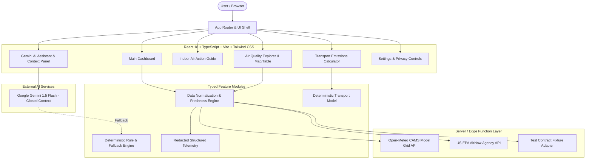

# BreatheWise AI — Urban Air Quality Assistant

> **Tagline:** Breathe Better. Live Smarter.  
> **Challenge:** PromptWars Virtual — Challenge 6: Urban Air Quality Assistant  
> **Status:** Production-Ready MVP (PromptWars Challenge 6 Compliant)

BreatheWise AI is an urban air-quality intelligence web application that transforms raw atmospheric data into clear, actionable, personalized choices. Its core value is **decision-grade transparency and practical advice** — without inventing live readings, overpromising safety, or diagnosing medical conditions.

---

## Architecture Diagram



---

## Product Purpose & Target Market

### Target Users
- **Households & Caregivers:** Make daily indoor and outdoor decisions without complex jargon.
- **Commuters & Active Travelers:** Plan low-exposure routes and calculate transport emission trade-offs without false safety guarantees.
- **Sensitive Groups:** Access conservative, public health guidance without clinical profiling or diagnosis collection.
- **Community Educators:** Generate privacy-preserving, source-attributed local reports.

### Provider & Data Caveats
- **Open-Meteo Copernicus CAMS:** Global atmospheric transport model. Data is gridded (~11 km EU / ~45 km global), explicitly tagged as `estimate` and `grid` scope. Open data under CC BY 4.0 with attribution.
- **US EPA AirNow:** Ground station observations across the United States. Preliminary observational reporting.
- **Model Grid Limitations:** Chemical transport model grids reflect regional boundary layers, not hyper-local street canyons or indoor spaces.
- **Public Health Boundary:** Guidance is based on US EPA and WHO guidelines. BreatheWise is informational and does not provide medical care or diagnosis.

---

## Feature Implementation Status

| Feature Module | Blueprint Priority | Implementation Status | Test Coverage |
| :--- | :---: | :---: | :---: |
| **Provenance-First AQI Card** | P0 | ✅ Completed | Fully verified (freshness, scales, types) |
| **Physical Pollutants Grid** | P0 | ✅ Completed | Raw units preserved ($\mu\text{g/m}^3$, ppm) |
| **Hourly Trend & Accessible Table** | P0 | ✅ Completed | Interactive sparkline + WCAG table |
| **Evidence-Linked Daily Actions** | P0 | ✅ Completed | Ranked routines with WHO/EPA citations |
| **Indoor Air Quality Guide** | P0 | ✅ Completed | Source reduction, ventilation, CADR sizing |
| **Transport Emissions Calculator**| P0 | ✅ Completed | Deterministic $g\text{ CO}_2\text{e}$ math with boundaries |
| **Community Share Card** | P0 | ✅ Completed | Coarsened coordinates (~1.1 km), no user IDs |
| **Closed-Context Gemini Assistant**| P0 | ✅ Completed | Prompt-injection defense & deterministic fallback |
| **Settings & Cascade Deletion** | P0 | ✅ Completed | LocalStorage purge, unit toggles, provider switch |
| **Air Quality Explorer & Map** | P0 | ✅ Completed | Leaflet/OSM compliant + accessible table |
| **Daily Routine Planner** | P1 | ✅ Completed | Proposal blocks (forecast — not a guarantee) |

---

## Getting Started

### Prerequisites
- Node.js 18.0+
- npm 9.0+

### Local Setup

1. **Clone and install dependencies:**
   ```bash
   git clone https://github.com/chandumutchumari/breathewise-ai.git
   cd breathewise-ai
   npm install
   ```

2. **Run local development server:**
   ```bash
   npm run dev
   ```
   Open `http://localhost:3000` in your browser.

3. **Run code quality linting:**
   ```bash
   npm run lint
   ```

4. **Run automated test suite:**
   ```bash
   npm test
   ```

5. **Build for production:**
   ```bash
   npm run build
   ```

---

## Environment Variables

Copy `.env.example` to `.env.local` to configure optional server integrations. The core application runs out of the box with zero keys using Open-Meteo and the deterministic recommendation engine.

| Variable | Required | Description |
| :--- | :---: | :--- |
| `GEMINI_API_KEY` | Optional | Google Gemini API Key for LLM recommendations. Defaults to deterministic rule engine when omitted. |
| `AIRNOW_API_KEY` | Optional | US EPA AirNow API Key for US regulatory station observations. |
| `VITE_SUPABASE_URL` | Optional | Supabase Project URL for Edge Functions and PostgreSQL. |
| `VITE_SUPABASE_ANON_KEY` | Optional | Public anonymous client key with RLS enforcement. |

---

## Database Migrations & Security (Supabase)

Database migrations are located in `supabase/migrations/20261123000000_breathewise_schema.sql`.

### Security Highlights
- **Least Privilege:** Anonymous and authenticated table privileges are explicitly revoked before granting minimal required operations.
- **Row-Level Security (RLS):** Strict owner-only policies on `profiles`, `user_preferences`, `saved_locations`, and `impact_calculations`.
- **Public Read:** `provider_sources` is restricted to approved display fields only.
- **Privacy Coarsening:** Saved locations store coarsened coordinates (`NUMERIC(6, 3)` ~1.1 km) to prevent exact home address leaks.

To apply migrations locally with the Supabase CLI:
```bash
supabase start
supabase db push
```

---

## Automated Test Suite

Vitest automated test suite contains **25 unit and contract tests across 9 test suites**:

| Test Suite | File | Tests | Key Invariants Verified |
| :--- | :--- | :---: | :--- |
| **AQI Categories** | `src/test/aqi-categories.test.ts` | 3 | EPA 0-500 thresholds, EAQI mapping, unknown scale rejection |
| **Freshness Engine** | `src/test/freshness.test.ts` | 4 | Fresh (<60m), Delayed (<180m), Stale (>180m), Unavailable states |
| **Data Normalization**| `src/test/data-normalization.test.ts`| 2 | AQI index separation from concentration; raw unit preservation |
| **Impact Calculator** | `src/test/impact-calculator.test.ts` | 3 | Miles/km conversion, zero boundaries, negative savings |
| **Advisor Rules** | `src/test/advisor-rules.test.ts` | 3 | Evidence ID links, stale schedule suspension, missing data fallback |
| **Security Injection**| `src/test/security-injection.test.ts`| 2 | Prompt injection boundary alerts, source reduction answers |
| **Privacy Redaction** | `src/test/privacy-and-redaction.test.ts` | 2 | Coordinate coarsening (~1.1 km), share card stripping of IDs |
| **Provider Resilience**| `src/test/provider-resilience.test.ts` | 3 | Unconfigured state detection, stale fixture flags, offline monitors |
| **Evidence Validation**| `src/test/evidence-validation.test.ts` | 3 | Public guidance URLs, rejection of hallucinated citation IDs |

Run all tests:
```bash
npm test
```

---

## Known Limitations

1. **Regional Model Grids:** Open-Meteo CAMS provides gridded transport model estimates. Localized street-level microclimates and street canyon effects may differ from regional grid values.
2. **Indoor vs. Outdoor:** Ambient air quality readings do not reflect indoor spaces. Indoor air quality depends on indoor cooking, dust resuspension, and mechanical filtration.
3. **Emissions Boundaries:** Greenhouse gas ($g\text{ CO}_2\text{e}$) transport calculations are distinct from local $\text{PM}_{2.5}$ reductions. A reduction in vehicle greenhouse emissions does not imply zero particulate exposure on high-traffic roadways.

---

## Attributions & Reference Guidance

- **Copernicus Atmosphere Monitoring Service (CAMS) & Open-Meteo:** [Open-Meteo Air Quality API](https://open-meteo.com) under CC BY 4.0.
- **US EPA AirNow:** [Air Quality Index Basics](https://www.airnow.gov/aqi/aqi-basics/).
- **World Health Organization (WHO):** [Global Air Quality Guidelines (2021)](https://www.who.int/publications/i/item/9789240034228).
- **US EPA Indoor Environments Division:** [Air Cleaners and Air Filters in the Home](https://www.epa.gov/indoor-air-quality-iaq/air-cleaners-and-air-filters-home).
- **OpenStreetMap Contributors:** Map tiles and geographic data under [ODbL](https://www.openstreetmap.org/copyright).

---

## Demo Walkthrough

1. **Landing Page:** Review the privacy-first CTA, illustrative sample UI notice, and three-step "Check → Understand → Choose" overview.
2. **Dashboard:** View the primary AQI card, physical pollutant tiles ($\mu\text{g/m}^3$), and multi-hour trend graph with the accessible table toggle.
3. **Evidence-Linked Actions:** Inspect 3–4 practical recommendations with WHO/EPA evidence basis chips.
4. **Indoor Guide:** Test the CADR room dimension sizing calculator and explore the zero-cost DIY Corsi-Rosenthal box filter guide.
5. **Impact Tracker:** Calculate commute greenhouse gas differentials ($g\text{ CO}_2\text{e}$) with boundary limitation disclosures.
6. **AI Assistant:** Test suggested prompts ("How can I reduce cooking smoke?") and prompt-injection defense.
7. **Settings:** Test unit switching, broad sensitive-group guidance toggle, and the complete data deletion cascade.
